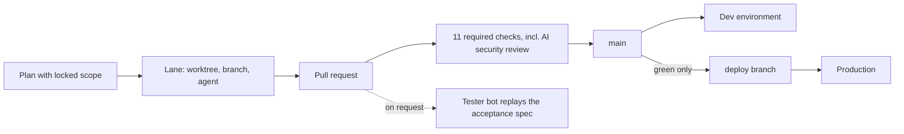

# Navigo Intelligence: engineering case study

Marcell Bierbauer-Szigeti, co-founder and CTO. Written 2026-10-15.

The code is private. This repo holds the decisions, the numbers behind them (counted 2026-10-15) and three short excerpts of the real code in [`excerpts/`](excerpts/).

## The short version

Navigo Intelligence is a small, self-funded software company near Zurich. We build back-office software for Swiss construction and fiduciary firms: the software does the preparation (reading documents, drafting, tracking deadlines) and stops wherever a qualified person has to decide.

- **Bau** documents construction sites: plans, defects with work orders per contractor, site journal, meeting reports. It is multi-tenant. First customer live in production since September 2026.
- **Treu** is an AI-assisted workflow for fiduciary firms preparing private Zurich tax returns. Every figure the model reads stays a candidate until a named fiduciary confirms it. Demo stage, no customer yet.

I own the architecture, from the first commit in March 2026, including the multi-tenant core and the lock on outward sends. I split our one platform into the two products, set up Bau's production, built Treu and run the company's infrastructure.

Coding agents (Claude Code) write the code. I decide what gets built, write the specs and acceptance criteria, run the pipeline that decides what merges, and I'm accountable for what ships. How that works is [further down](#how-the-code-gets-written).

Four decisions worth reading:

1. [Tenant isolation lives in Postgres](#1-tenant-isolation-lives-in-postgres)
2. [The AI proposes, a person sends](#2-the-ai-proposes-a-person-sends)
3. [The product says where the data runs](#3-the-product-says-where-the-data-runs)
4. [Two products, opposite tenancy](#4-two-products-opposite-tenancy)

## 1. Tenant isolation lives in Postgres

Bau keeps many companies' site records in one database. One missing `WHERE tenant_id = ...`, written by a person or an agent, would show one company another company's defects.

So tenant data is isolated by Postgres row-level security, not by application code. The app connects as a non-superuser role, because a superuser bypasses RLS and every isolation test would pass for the wrong reason. Each RLS table follows one of five documented scope patterns, and database-backed tests check the live policies against that list. The tables outside RLS are platform tables, reference data and a few token and telemetry tables, each documented with its reason.

In June we found that the tenant context lived on the pooled database connection, not on the transaction. That one cause gave us two bugs. A chat crashed when it resumed after a confirmation, because a commit in between had dropped the context. Worse, the day we turned on transaction pooling, one tenant's context could have carried into the next tenant's transaction.

The fix, by Laszlo, who builds Bau with me, binds the context to the transaction: it is re-applied at the start of every transaction, and Postgres drops it at the end. See [`excerpts/02_rls_transaction_context.py`](excerpts/02_rls_transaction_context.py). We rejected the cheaper fix, re-setting the context after every commit at each call site, because it relies on every future author, human or agent, remembering to do it.

A query with no tenant context raises an error instead of returning rows. Softening that to empty results would have hidden the very bug that started this. The cost is that a missing-context bug shows up as an error in front of a user.

**Evidence (2026-10-15).** After applying all migrations to a fresh Postgres 16: 84 tables in the `public` schema, 71 of them with RLS enabled and forced, 77 policies. The isolation suite ran 1,748 tests (pytest items, parametrized cases included) against that database, all passed, in about a minute on four workers.

## 2. The AI proposes, a person sends

Bau sends reports, documents and messages to people outside the customer's company. A report sent to the wrong subcontractor cannot be taken back.

Write tools need a person's confirmation by default. Tenants may switch that off for ordinary internal writes, and the audit row records that they did. A security review in June found that the same per-tenant switch also worked on outward sends. For those tools the opt-out itself is the vulnerability. I made the lock a property of the tool class: a tool can declare `confirmation_locked`, and the lock wins before any configuration is read. The exact bypass the review found became a regression test: [`excerpts/01_confirmation_lock_test.py`](excerpts/01_confirmation_lock_test.py).

Leaving outward sends on the switch and relying on the audit row was the softer option; the row would only tell us afterwards. The cost is one more click on every outward send.

Every API mutation also has to show its audit row to a CI gate that Laszlo wrote. It parses every mutating route handler and fails the build unless the handler builds an audit row, before its own commit, or is exempt with a stated reason. It is a syntactic check, not path analysis, and it catches the common mistake cheaply. See [`excerpts/03_audit_before_commit_gate.py`](excerpts/03_audit_before_commit_gate.py).

Treu applies the same idea to the model's reading. A figure read from a document is shown as unconfirmed until a named fiduciary confirms it, and the audit trail records the documents, the rule and the model and prompt version behind each proposal. Only fixed-text housekeeping mail leaves without a person (a missing document, a duplicate, reminders a fiduciary switched on), and no model writes it. Anything with a figure or advice waits for a named release; anything to the tax authority is done by a person. I don't publish an accuracy figure for the reading: we have not run it on enough real documents to state one honestly.

**Evidence (2026-10-15).** 6 tools declare `confirmation_locked`: the four that send site reports, meeting reports, documents and work-order messages to people outside the customer's company, plus two internal ones: accepting a suggested action, which may itself trigger a locked write, and publishing a note to the whole team's shared knowledge.

## 3. The product says where the data runs

A fiduciary firm wants to know where its clients' data is processed. The honest answer depends on configuration, and changes when someone picks a different model.

In Treu, a fence refuses any AWS region outside Zurich when the model client or the outbound mail client is created, so a misconfigured instance fails before any data is sent.

A page in the product («Datenhaltung», data storage) is generated from the instance's own configuration. If a cross-region inference profile is configured, the page says the reading may run outside Switzerland. It also names the one hop we cannot avoid: mail from clients waits in Frankfurt until the instance fetches it, because AWS offers no mail receiving in Zurich.

In Bau, a model call pinned to the EU raises a hard error rather than silently falling back to another provider.

We don't put "your data stays in Switzerland" on the website, for either product. Bau's production server is in Germany, and the EU pin does not cover every call yet. It is a less comforting sales answer. I would rather a customer read the true one on that page than find it later.

## 4. Two products, opposite tenancy

In September our one platform repo held the construction product next to code for other product directions. The fiduciary product, built next, needed the opposite tenancy shape.

**Treu: a new repo from a spec, one instance per firm.** Each firm gets its own database, files and address. There is no tenant column and no RLS; isolation is physical. A fiduciary can tell a client "your data sits in our own instance" without having to trust our policies, and a query bug cannot show one firm's records to another firm. The cost: no single deployment for all firms, and cross-firm reporting has to be rebuilt as a thin separate report.

**Bau: cut out of the platform by subtraction.** That was my call. Bau's multi-tenant core was the hardest and best-tested part of the code, and a rewrite would have lost exactly that. Bau became a new repo cut from the platform's full history; the old repo is archived read-only, so every removed line stays reachable. The cost: Bau did not get a smaller, fresher codebase on day one.

Treu started on 2026-09-23, Bau was cut on 2026-09-24, and Bau went into production with its first customer two days later.

## How the code gets written

On Bau, 2,200 of 2,476 commits (89%, including the history inherited from the platform) have Claude Code as author or co-author; on Treu, 356 of 389. My time goes into the work around them.

- Each larger piece of work starts as a written plan that says what is in scope and what is not (Bau: 135 plans, 103 done). Decisions go into a numbered log, most with what was given up.
- A lane is one git worktree with one branch, one plan and one agent session. Lanes run in parallel, unattended if needed, on a build machine that holds no cloud credentials. I built [laneboard](https://github.com/FrostyyTiger/laneboard), public, to watch them.
- Bau's `main` has 11 required checks that apply to everyone, admins included: tests, a migration rehearsal on a seeded database, a secret scan, a mutation-score ratchet, and an AI security review (it checks tenant isolation) that Laszlo made a required merge check. It reads the pull request's code and never runs it. Any blocker it raises has to come with a test that proves it.
- The checks that decide what lands on `main` each run on a fresh single-use VM, with no secrets and no network path to our machines. I call this the clean room. A USD 111 GitHub Actions bill in September started it; keeping pull-request code away from anything with secrets is why it stays.
- Each requirement gets one Playwright acceptance spec. Assign the task to a tester account, and a bot I built deploys that branch to a rebuildable test environment, replays exactly that spec and drafts a PASS, FAIL or UNCLEAR comment with screenshots for a person to approve.
- Production follows a `deploy` branch that CI moves only to a green `main` commit, never edited by hand.

Agents and gates get things wrong in ordinary ways. The first version of the audit exemption list named three route handlers that did not exist; they never fired and never failed. The AI security review's second pass caught it the same day, and a test now fails on any phantom exemption.

Some mistakes no gate catches. The upload code sent plan files one at a time, on purpose: an earlier rule said parallel uploads buy nothing on a building-site connection. On 2026-10-13 I timed a 4,502-file test folder in production: about 1.7 seconds per small file, over two hours in total, almost all of it round trips. The rule was right for large files and wrong for small plans, so I changed it to four uploads at a time, large files alone. Real plan folders also hit browser limits, so I started a desktop sync client in Tauri and Rust, not yet signed or released.

## Running it in production

Bau production is one rented server in Germany running the repo's own container stack behind a CDN. AWS keeps login (Cognito), files in a Zurich bucket (S3) and the model (Claude on Bedrock, configured for an EU region). Backups are nightly and encrypted; the first restore drill ran before the first customer login.

## What's not solved

- **The EU pin is per call site.** Some model calls in Bau sit outside it, and the check meant to catch that is not yet fine-grained enough.
- **Treu's acceptance specs are mostly skipped.** A UI redesign retired most of them, and they have not been rewritten. The tester bot works on Bau; on Treu it has little to replay until they are.

## Who built what

Laszlo builds the construction product with me, and since the split he has written most of its changes. Several of Bau's strongest gates are his: the transaction-scoped tenant context, the audit gate, the workflow approval gate, the AI security review as a required merge check, and the mutation-score ratchet. Mine are the architecture and the first RLS backbone, most of the isolation suite, the security-reviewer agent definition the review runs on (May 2026), the confirmation lock, the split into two products, Bau's production and the CI clean room. Outside Bau I built Treu, the company infrastructure, the tester bot, laneboard and the desktop sync client. Several of these came out of sessions where we argued them through together.

---

[github.com/FrostyyTiger](https://github.com/FrostyyTiger) · marcellbierbauer@gmail.com · [LinkedIn](https://www.linkedin.com/in/marcel-bierbauer-szigeti-0665001ba)
